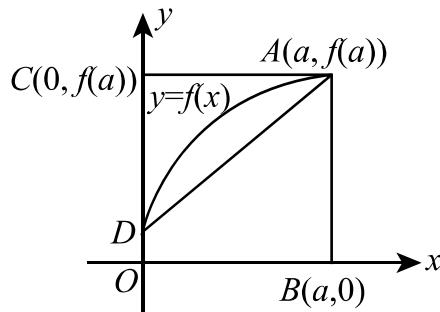

# 408 + 数学二 题图 · GitHub 图床

就是一个 **public 仓库 + 两个图片文件夹**，完整镜像本地题库里的题目配图，文件名直接使用题号。

| 文件夹 | 数量 | 体积 |
| --- | ---: | ---: |
| `images/408/` | 137 张 | 约 2.73 MB |
| `images/math2/` | 29 张 | 约 0.32 MB |
| **合计** | **166 张** | **约 3.05 MB** |

## 预览

408（2024-11，外排序败者树）：


数学二（2008-2）：



## 外链格式

```text
https://raw.githubusercontent.com/h753951/github-image-bed/main/images/408/<题号>.jpg
https://raw.githubusercontent.com/h753951/github-image-bed/main/images/math2/<题号>.jpg
```

例如：

```text
https://raw.githubusercontent.com/h753951/github-image-bed/main/images/408/2024-11.jpg
https://raw.githubusercontent.com/h753951/github-image-bed/main/images/408/2017-8_1.jpg
https://raw.githubusercontent.com/h753951/github-image-bed/main/images/math2/2008-2.jpg
```

Markdown：

```markdown

```

HTML：

```html

```

在 408 题库数据里替换时：

```text
改前：

改后：
```

数学二同理：

```text
改前：

改后：
```

## 按题号找图

文件名现在就是题号，直接进 `images/408/` 或 `images/math2/` 就能按年份、题号找。

在 GitHub 仓库页面按 `t` 打开文件搜索，输入 `2024-11` 或 `2008-2` 也能直接定位。

一题多图用后缀区分：

```text
2017-8_1.jpg ~ 2017-8_4.jpg
2001-10_1.jpg ~ 2001-10_5.jpg
```

少数特殊情况看 [`题号索引.csv`](题号索引.csv)：

- `2016-33` ~ `2016-41` 共用一张图，文件名为 `2016-33.jpg`；
- 408 有 3 张没关联题号的图，命名为 `misc-1.jpg` ~ `misc-3.jpg`；
- 索引列：`project,question_id,file,url`，一个题多张图就多行。

用 Excel / VSCode 打开索引，`Ctrl+F` 搜题号；或者在 PowerShell 里筛：

```powershell
Import-Csv .\题号索引.csv | Where-Object { $_.question_id -eq '2017-8' } | Select-Object file,url
```

## 文件名说明

- 单图题：`<题号>.jpg`，如 `2024-11.jpg`；
- 多图题：`<题号>_1.jpg`、`<题号>_2.jpg`，顺序按题库原文出现顺序；
- 共用图：按第一次出现的题号命名，其他题号在索引里指向同一个文件；
- 无题号图：`misc-1.jpg` ~ `misc-3.jpg`。

## 更新

图片有增删时，在本地替换 `images/` 下对应文件，然后：

```powershell
cd D:\my_projects\github-image-bed
git add -A
git commit -m "Update question images"
git push
```

## 注意

- 仓库是 **public**，raw 链接才能匿名访问。
- GitHub 单文件上限 100 MB，这些图都很小。
- 不要用 Git LFS，raw 只会返回指针文本，不是图片。
- raw 有约 5 分钟缓存，刚 push 完看不到新图是正常的。
- 真题图片版权归原权利人，这里只做个人学习和技术测试。
