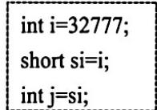

# 408 题图 · GitHub 图床测试

就是一个 **public 仓库 + 一个图片文件夹**。先放 9 张 408 真题配图（6 道题，约 213 KB）试一下。

## 图片

```text
images/408/
├─ 2017-8-1.jpg ~ 2017-8-4.jpg   数据结构 · 查找（4 张选项图）
├─ 2018-44.jpg                   计算机组成原理 · 存储层次
├─ 2020-47.jpg                   计算机网络 · 网络层
├─ 2022-45.jpg                   操作系统 · 文件管理
├─ 2024-11.jpg                   数据结构 · 排序
└─ 2024-43.jpg                   计算机组成原理 · CPU
```

## 预览

推送后，下面这张图应该能直接在 GitHub 的 README 里显示：



## 外链怎么用

推送后，把路径拼到 raw 域名后面：

```text
https://raw.githubusercontent.com/h753951/github-image-bed/main/images/408/2024-11.jpg
```

Markdown：

```markdown

```

HTML：

```html

```

如果仓库名或用户名不同，把 URL 里的 `h753951/github-image-bed` 换掉即可。

## 推送

本目录已经 `git init` 并提交，remote 指向 `https://github.com/h753951/github-image-bed.git`。
先在 GitHub 建一个 **public** 空仓库（不要勾选 README），然后：

```powershell
cd D:\my_projects\github-image-bed
git push -u origin main
```

仓库名不一样的话：

```powershell
git remote set-url origin https://github.com/<你的用户名>/<仓库名>.git
git push -u origin main
```

## 注意

- 仓库必须是 **public**，raw 链接才能匿名访问。
- GitHub 单文件上限 100 MB；这些图都很小，没问题。
- 不要用 Git LFS，raw 只会返回指针文本，不是图片。
- raw 有约 5 分钟缓存，刚 push 完看不到新图是正常的。
- 真题图片版权归原权利人，这里只做个人学习和技术测试。
